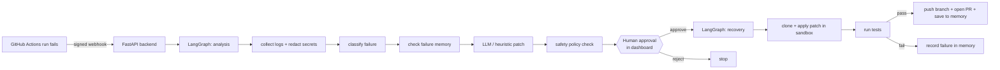

# Self-Healing CI/CD

An AI pipeline that **watches your GitHub Actions, finds out why a build failed, writes a fix, asks a human to approve it, tests the fix in a sandbox, and opens a pull request** only if the tests pass.

> Nothing is merged or pushed to your main branch automatically. A human approves every fix, and the fix must pass tests first.

## How it works



| Stage | What happens |
|---|---|
| Detect | GitHub sends a signed `workflow_run` event (or the included notify workflow does). |
| Analyze | Logs are cleaned of secrets, classified (dependency, test, lint, type, build, timeout, network, config), and matched against past failures. |
| Remember | A normalized "signature" of the error is stored. If the same failure comes back and the old fix worked, it is reused with no LLM call. |
| Patch | Groq or Gemini returns search/replace edits as JSON. If the LLM fails or no key is set, offline rules take over. |
| Approve | The Next.js dashboard shows the diff. A person approves or rejects. |
| Verify | The patch runs on a fresh clone in a sandbox (Docker or local). Tests must pass. |
| Recover | A branch is pushed and a PR is opened with the root cause and test result. |

## Tech stack

Python 3.12 · FastAPI · LangGraph · SQLAlchemy · PostgreSQL · Groq / Gemini · Docker · GitHub Actions · Next.js 16 (React 19, TypeScript)

## Quick start (local, no API keys needed)

```bash
# 1. Backend
cd backend
python -m venv .venv && source .venv/bin/activate      # Windows: .venv\Scripts\activate
pip install -r requirements-dev.txt
python -m pytest -q                                    # 31 tests
cp ../.env.example .env                                # then edit: set API_KEY, SANDBOX_MODE=local
DATABASE_URL=sqlite:///./dev.db uvicorn app.main:app --reload

# 2. Frontend (new terminal)
cd frontend
npm ci
cp .env.example .env.local                             # set BACKEND_API_KEY = backend API_KEY
npm run dev                                            # http://localhost:3000
```

Create a test incident without GitHub:

```bash
curl -X POST localhost:8000/incidents -H "X-API-Key: $API_KEY" -H "Content-Type: application/json" \
  -d '{"repo":"owner/name","run_id":1,"logs":"ModuleNotFoundError: No module named '"'"'yaml'"'"'"}'
```

### With Docker Compose (PostgreSQL included)

```bash
cp .env.example backend/.env           # fill in API_KEY, GITHUB_WEBHOOK_SECRET, etc.
export API_KEY=...  DASHBOARD_PASSWORD=...
docker compose up --build              # dashboard :3000, API :8000
```

For the isolated Docker sandbox see [docs/SECURITY.md](docs/SECURITY.md) before using `docker-compose.sandbox.yml`.

## Configuration

All settings are environment variables. See [`.env.example`](.env.example). **Never commit or share real `.env` files** (they are in `.gitignore`).

| Variable | Purpose |
|---|---|
| `DATABASE_URL` | PostgreSQL URL (SQLite works for dev) |
| `API_KEY` | Protects every admin endpoint (`X-API-Key` header) |
| `GITHUB_WEBHOOK_SECRET` | Verifies webhook signatures |
| `GITHUB_TOKEN` | Fine-grained token: Contents RW, Pull requests RW, Actions R |
| `LLM_PROVIDER` | `groq`, `gemini`, or `heuristic` |
| `SANDBOX_MODE` | `docker` (isolated) or `local` (dev only) |

## API

| Method & path | Auth | Purpose |
|---|---|---|
| `GET /health` | none | Liveness + DB check |
| `POST /webhooks/github` | HMAC signature | Receive failed runs |
| `POST /incidents` | API key | Create an incident manually |
| `GET /incidents`, `GET /incidents/{id}` | API key | List / details, patch, logs, audit trail |
| `POST /incidents/{id}/approve` · `/reject` | API key | Human decision (one-time, atomic) |
| `GET /stats` · `GET /memory` · `GET /metrics` | API key | Dashboard data, failure memory, Prometheus metrics |

Interactive docs: `/docs`.

## Connect a repository

1. In the repo: **Settings → Secrets → Actions**, add `SELFHEAL_URL` (your backend URL) and `SELFHEAL_WEBHOOK_SECRET` (same as backend `GITHUB_WEBHOOK_SECRET`).
2. Copy `.github/workflows/self-heal-notify.yml` into the repo and set `workflows:` to the names of the workflows to watch.
3. Make sure the backend `GITHUB_TOKEN` can access that repo.

## Security

Signed webhooks · API key with constant-time compare · secret redaction before storage and before the LLM · prompt-injection-aware prompt · patch policy (max 5 edits, no path tricks, `.github/`, `.git/` and `.env*` are blocked) · human approval · atomic one-time approval · sandbox with scrubbed environment (Docker adds CPU/RAM/PID limits and dropped capabilities) · token sent by header, never in URLs · audit log of every step · dashboard behind Basic auth with a server-side proxy so the API key never reaches the browser. Details and limits: [docs/SECURITY.md](docs/SECURITY.md).

## Project layout

```
backend/app/      main.py (API) · graph.py (LangGraph) · llm.py · classifier.py · memory.py
                  sandbox.py · security.py · github_client.py · models.py · config.py
backend/tests/    31 tests incl. a full recovery run on a real git repo
frontend/         Next.js dashboard + auth proxy
.github/workflows ci.yml · self-heal-notify.yml · deploy.yml
render.yaml · docker-compose*.yml
docs/             ARCHITECTURE · SECURITY · DEPLOYMENT
```

## Known limits (honest list)

- One patch attempt per approval. If tests fail, the incident is marked `failed`; a human must re-run analysis.
- Auto-detects `pytest` and `npm test` only. Set `DEFAULT_TEST_COMMAND` or the incident `test_command` for other stacks.
- Tables are created at startup (`create_all`). Add Alembic migrations before changing the schema in production.
- Failure memory matches by text similarity, not embeddings.
- The Docker sandbox needs a Docker host (not available on most PaaS free tiers).
